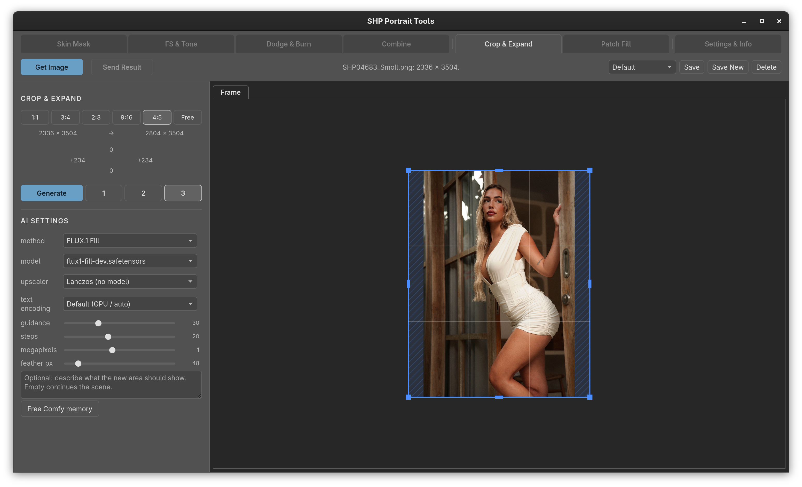
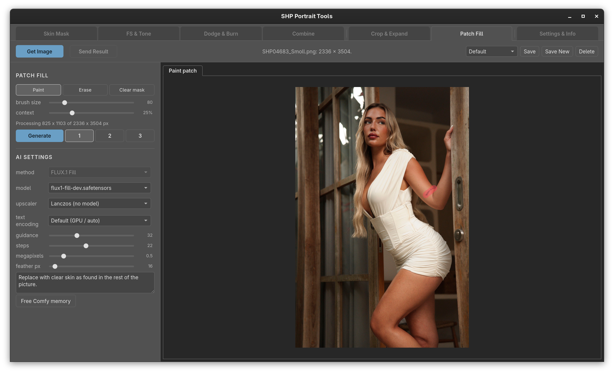

# SHP AI Fill

Local Crop & Expand and Patch Fill for portrait photography, run through your own
[ComfyUI](https://github.com/comfyanonymous/ComfyUI) installation. AI Fill used to be part of
[SHP Portrait Tools](https://github.com/stefhartog/shp-portrait-tools); it is now a separate app.

- **Crop & Expand** — reframe a picture and generate the surroundings with FLUX.2 dev,
  FLUX.1 Fill or FLUX.2 Klein. Klein has separate settings, a soft seam blend and
  optional compatible LoRA support.
- **Patch Fill** — paint an area to replace with FLUX.1 Fill while retaining surrounding context.

<p align="center">
  <a href="docs/images/crop-and-expand.png"></a>
  <a href="docs/images/patch-fill.png"></a>
</p>

Load a picture from a folder or get the active document from PhotoCraft, generate, then save a
PNG locally or send the result back to PhotoCraft as one layer (one undo step).

## Requirements

- Linux, Git, Python 3.13 and [uv](https://docs.astral.sh/uv/).
- ComfyUI in its **own** Python environment with a supported GPU, plus the models and custom
  nodes for the method you use. See [MODELS.md](MODELS.md). This project does not install
  ComfyUI or any model.
- Optional: PhotoCraft for Get/Send.

## Install and run

```sh
git clone https://github.com/stefhartog/shp-ai-fill.git "$HOME/shp-ai-fill"
cd "$HOME/shp-ai-fill"
uv python install 3.13
uv sync --locked
uv run --no-sync shp-photocraft-crop --dir "$HOME/Pictures" --comfy http://127.0.0.1:8188
```

Open the local address printed at startup (default `http://127.0.0.1:8768`). AI Fill is a web
app: there is no desktop window or tray icon. If ComfyUI is installed locally but not running,
the page can start it.

Settings, presets and results are stored where SHP Portrait Tools kept them
(`~/.local/share/shp-photocraft-tools/crop`, or `$SHPC_DATA`), so existing AI Fill data keeps
working. The `SHPC_*` and `SHP_PC_*` environment variables are unchanged.

## Tests

```sh
uv run --no-sync python tests/run.py
```

Tests use synthetic images and fake ComfyUI/PhotoCraft services; they do not need a GPU,
ComfyUI or models.
